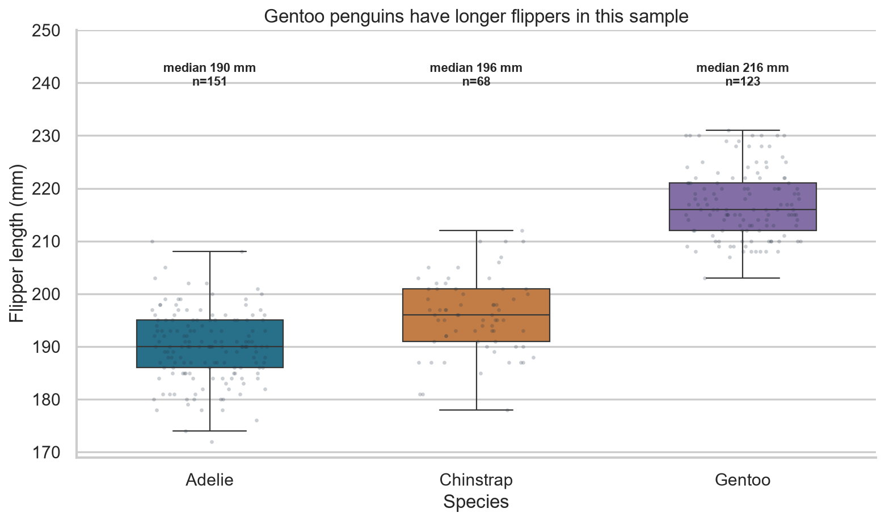
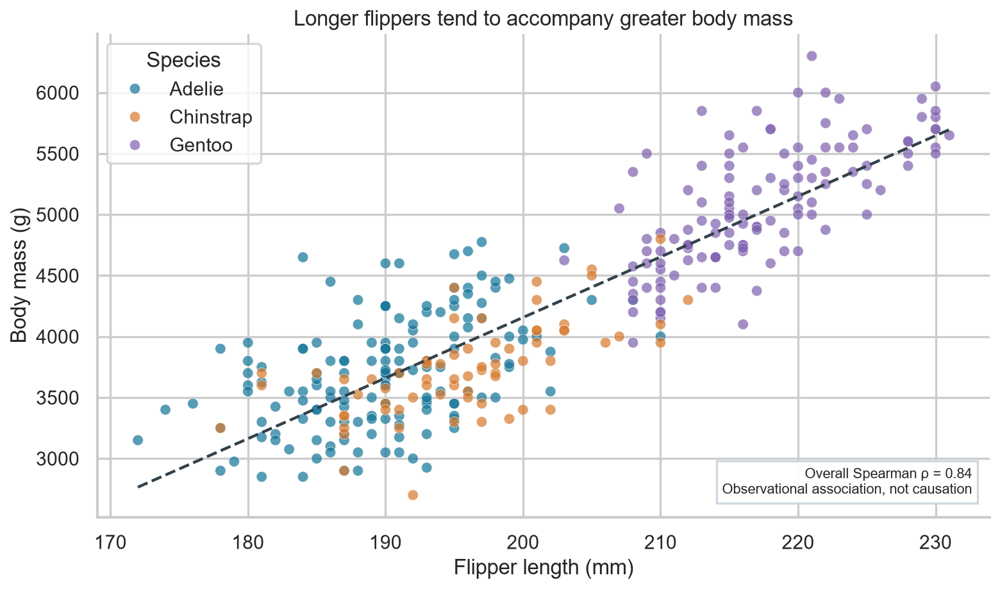

# Penguin body measurements: species differences and association

**Author:** He Yang (何洋)  
**Status:** Completed teaching portfolio analysis

## Question

How do flipper lengths differ among Adelie, Chinstrap, and Gentoo penguins in the Palmer Penguins sample? Within this sample, is longer flipper length associated with greater body mass?

## Dataset and permission

This project uses `data/penguins.csv` from the [palmerpenguins project](https://github.com/allisonhorst/palmerpenguins/blob/main/inst/extdata/penguins.csv). The dataset is distributed under [CC0 1.0](https://allisonhorst.github.io/palmerpenguins/LICENSE.html), which permits reuse and redistribution. The underlying measurements are credited in the [palmerpenguins documentation](https://github.com/allisonhorst/palmerpenguins). This repository contains no passwords, API keys, personal records, or restricted data.

## Methods and tools

`analysis.py` uses Python, pandas, seaborn, and Matplotlib. It removes rows lacking species, flipper length, or body mass; computes per-species medians and Spearman correlations; then creates a box-and-points plot and a scatterplot with a descriptive fitted line. The script writes `results.json` so reported figures can be checked against the data.

## Findings

The supplied data contain 344 records; 342 have complete species, flipper-length, and body-mass fields. Gentoo penguins have the longest median flipper length and highest median body mass of the three groups. Flipper length and body mass are positively associated in the combined sample, although the species clusters account for part of this pattern. The charts show observational relationships, not causal effects.





## Limitation

These observations come from particular sampled penguins in 2007–2009. They do not represent every penguin population. The combined fitted line is influenced by differences between species, so it should not be treated as a species-independent biological rule.

## Reproduce the analysis

From this repository's root, with Python 3 installed:

```bash
python -m pip install -r requirements.txt
python analysis.py
```

The script regenerates both PNG files under `figures/` and `results.json`. It uses only the included CSV, so no API key or network call is needed.
